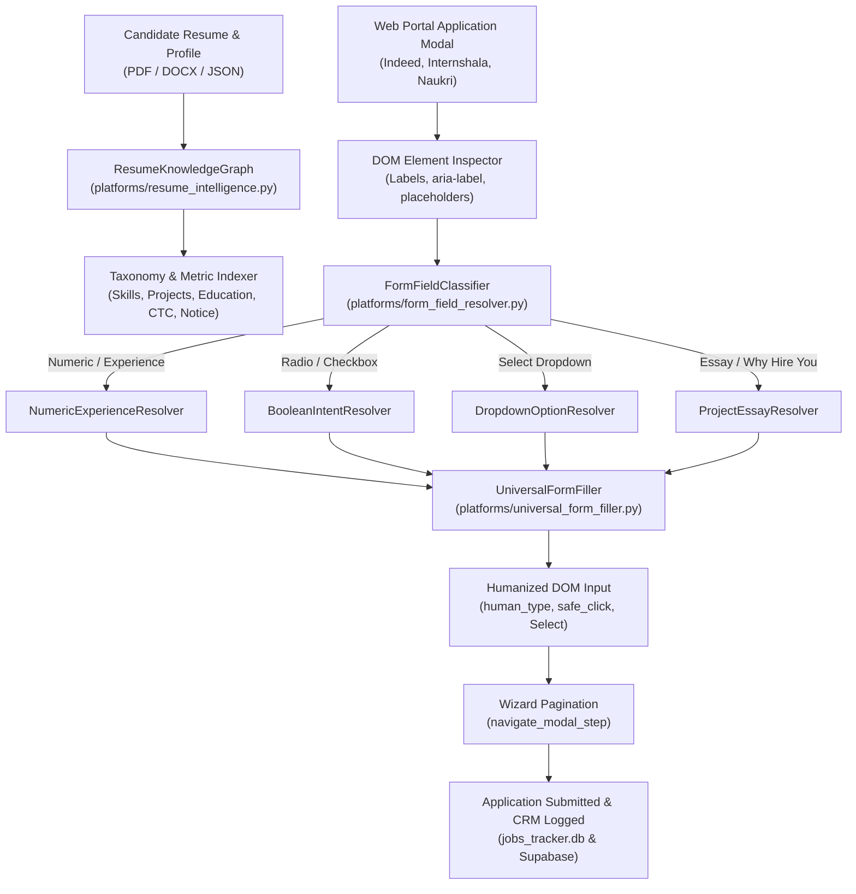

# AI-Driven Resume-Based Auto Form Filler & Bot Training Architecture

## 1. Overview
The **AI-Driven Resume-Based Auto Form Filler** eliminates repetitive, manual data entry during job applications across major portals (Naukri, Internshala, Indeed, LinkedIn, and generic ATS modals). Unlike generic AI bots that produce synthetic spam or hallucinated project details, this system grounds every answer directly in the candidate's verified resume profile.

---

## 2. Architecture & Pipeline



---

## 3. Core Engine Components

### A. Resume Knowledge Graph (`platforms/resume_intelligence.py`)
* Extracts candidate's verified skills, projects, academics, notice period, and CTC dynamically from the active user profile (`data/profile_data.json` or uploaded resume).
* **Multi-User Dynamic Grounding:** Guarantees that any user (not just one fixed individual) has form fields filled strictly with their own college, CGPA, projects, tech stack, and notice period.
* Generates authentic, project-grounded narratives, cover letter elevator pitches, and skill tenure estimates.

### B. Dynamic Candidate Profile Trainer (`backend/services/bot_training/profile_trainer.py`)
* Bridges candidate profile records into the bot's Q&A memory bank (`application_answers.csv`).
* Automatically runs via `python train_bot.py --train-for-user` or via API endpoint `POST /training/train-for-profile`.
* Rehydrates screening questions across 30+ domains with the candidate's exact degree, university, CGPA, coursework, notice period, CTC, and project descriptions.

### C. Semantic Form Field Resolvers (`platforms/form_field_resolver.py`)
1. **Numeric & Experience Resolver:** Matches requested skill (React, Node.js, Python, Java, etc.) against candidate's timeline and returns exact years.
2. **Boolean Intent Resolver:** Accurately answers "Yes" for relocation, hybrid, laptop readiness, background verification; answers "No" for visa sponsorship or unpaid roles.
3. **Dropdown Option Resolver:** Fuzzy-matches `<option>` tags for degree, notice period, location, and employment type using candidate's verified preferences.
4. **Project Essay Resolver:** Formulates authentic project narratives and situational answers dynamically synthesized from candidate's actual projects.

### D. Universal DOM Filler (`platforms/universal_form_filler.py`)
* **`human_type`:** Types character-by-character with randomized jitter (15ms - 45ms) to defeat anti-bot telemetry.
* **`safe_click_control`:** Scrolls elements into view and handles custom styled radios and checkboxes.
* **Dynamic Candidate Identity:** Populates first name, last name, email, phone, and city derived from active profile.

---

## 4. Seamless User Experience & Zero Landing Password Gate
* Landing page (`/`) is completely unlocked without any password prompt, enabling instant frictionless access for new users and fresh laptops.
* **`safe_click_control`:** Auto-scrolls target elements into center viewport and provides JavaScript fallback for overlaid controls.
* **`select_dropdown_option`:** Handles standard `<select>` and modern custom React/Tailwind listboxes.
* **`navigate_modal_step`:** Automates multi-step wizards through "Continue", "Next", and "Submit application" triggers.

---

## 4. Bot Training & Q&A Datasets
The bot is trained on 20+ specialized domain Q&A datasets located in `backend/services/bot_training/datasets/`:
* `resume_projects_qa.json`
* `react_frontend_deep_qa.json`
* `nodejs_backend_deep_qa.json`
* `database_sql_nosql_qa.json`
* `mongodb_nosql_qa.json`
* `javascript_typescript_qa.json`
* `python_automation_qa.json`
* `git_cicd_version_control_qa.json`
* `auth_security_rbac_qa.json`
* `web_performance_optimization_qa.json`
* `testing_debugging_quality_qa.json`
* `college_academics_coursework_qa.json`
* `situational_problem_solving_qa.json`
* `teamwork_agile_collaboration_qa.json`
* `notice_period_immediate_joining_qa.json`
* `compensation_stipend_expectations_qa.json`
* `work_authorization_shift_readiness_qa.json`

Sync all datasets anytime into the master answer bank with:
```bash
python train_bot.py --sync
```

