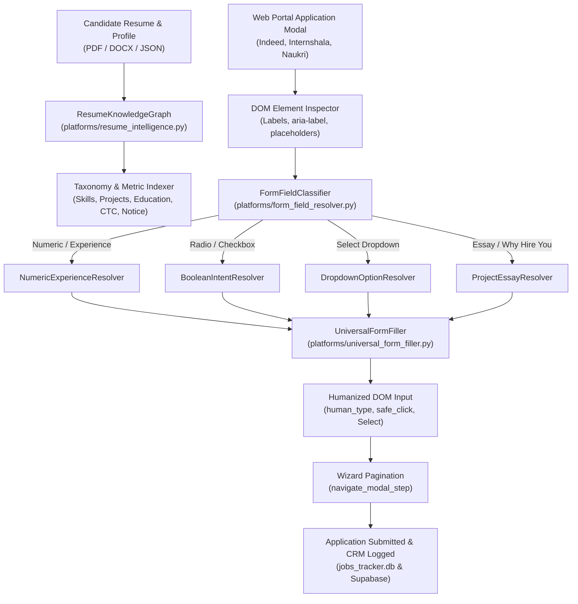

# AI-Driven Resume-Based Auto Form Filler & Bot Training Architecture

## 1. Overview
The **AI-Driven Resume-Based Auto Form Filler** eliminates repetitive, manual data entry during job applications across major portals (Naukri, Internshala, Indeed, LinkedIn, and generic ATS modals). Unlike generic AI bots that produce synthetic spam or hallucinated project details, this system grounds every answer directly in the candidate's verified resume profile.

---

## 2. Architecture & Pipeline



---

## 3. Core Engine Components

### A. Resume Knowledge Graph (`platforms/resume_intelligence.py`)
* Extracts candidate's verified skills, projects, and metrics.
* Projects Grounding:
  - **EdTech Learning Platform:** Full-stack React, Node.js/Express, Supabase PostgreSQL with RBAC, Storage.
  - **ByteFest 2K25:** High-traffic event portal handling 2,000+ daily visitors and 1,500+ registrations.
  - **Automobile Inventory System:** MongoDB, Express, React, Node.js with CRUD search and CSV audit export.
* Academic Grounding:
  - **Degree:** Bachelor of Technology (B.Tech) in Computer Science and Engineering.
  - **College:** MBES College of Engineering, Ambajogai, Maharashtra (Batch 2025, 6.06 CGPA).

### B. Semantic Form Field Resolvers (`platforms/form_field_resolver.py`)
1. **Numeric & Experience Resolver:** Matches requested skill (React, Node.js, PostgreSQL) against candidate's timeline and returns exact years.
2. **Boolean Intent Resolver:** Accurately answers "Yes" for relocation, hybrid, laptop readiness, background verification; answers "No" for visa sponsorship or unpaid roles.
3. **Dropdown Option Resolver:** Fuzzy-matches `<option>` tags for degree (`B.Tech`), notice period (`Immediate (0 Days)`), location (`Pune`, `Remote`), and employment type.
4. **Project Essay Resolver:** Formulates authentic project narratives and situational answers without generic fluff.

### C. Universal DOM Filler (`platforms/universal_form_filler.py`)
* **`human_type`:** Types character-by-character with randomized jitter (15ms - 45ms) to defeat anti-bot telemetry.
* **`safe_click_control`:** Auto-scrolls target elements into center viewport and provides JavaScript fallback for overlaid controls.
* **`select_dropdown_option`:** Handles standard `<select>` and modern custom React/Tailwind listboxes.
* **`navigate_modal_step`:** Automates multi-step wizards through "Continue", "Next", and "Submit application" triggers.

---

## 4. Bot Training & Q&A Datasets
The bot is trained on 20+ specialized domain Q&A datasets located in `backend/services/bot_training/datasets/`:
* `resume_projects_qa.json`
* `react_frontend_deep_qa.json`
* `nodejs_backend_deep_qa.json`
* `database_sql_nosql_qa.json`
* `mongodb_nosql_qa.json`
* `javascript_typescript_qa.json`
* `python_automation_qa.json`
* `git_cicd_version_control_qa.json`
* `auth_security_rbac_qa.json`
* `web_performance_optimization_qa.json`
* `testing_debugging_quality_qa.json`
* `college_academics_coursework_qa.json`
* `situational_problem_solving_qa.json`
* `teamwork_agile_collaboration_qa.json`
* `notice_period_immediate_joining_qa.json`
* `compensation_stipend_expectations_qa.json`
* `work_authorization_shift_readiness_qa.json`

Sync all datasets anytime into the master answer bank with:
```bash
python train_bot.py --sync
```
