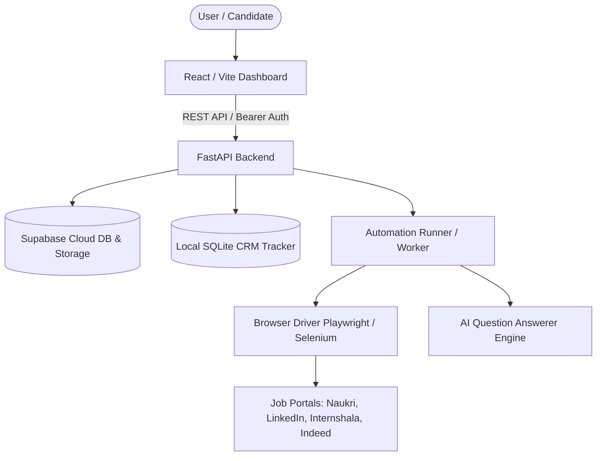

# Universal Job Auto-Apply Bot - Architecture Overview

## 1. System Architecture

The Universal Job Auto-Apply Bot is structured as a modern hybrid application combining a Python FastAPI backend, a React/TypeScript frontend (Vite + Tailwind CSS), and automated headless browser drivers (Playwright & Selenium) integrated with Supabase for cloud state synchronization.



## 2. Core Modules

### 2.1 Frontend (`frontend/src/`)
- **Dashboard & CRM**: Real-time status of submitted applications, active bot tasks, platform connection cards, and onboarding wizard.
- **Admin Command Center**: Role-based candidate monitoring, portal rate-limit throttles, and telemetry audit streams.
- **Client Services**: Type-safe REST client communicating with FastAPI endpoints.

### 2.2 Backend (`backend/`)
- **FastAPI Core**: Async REST API handling authentication verification, resume parsing, job task dispatch, and application telemetry.
- **Worker / Task Queue**: Asynchronous background task scheduler executing automated application flows with retry and rate-limiting logic.
- **Services**: Business logic modularized into `profile_service`, `application_service`, `task_service`, `admin_service`, and `resume_parser`.

### 2.3 Automation & Platform Adapters (`platforms/`)
- **Browser Manager**: Manages headless and visible browser sessions with stealth configurations, cookie retention, and user-agent rotation.
- **Platform Adapters**: Dedicated scrapers and form automators for Naukri, LinkedIn, Internshala, and Indeed.
- **AI Answerer**: Natural language processing utility for answering common application screening questions (e.g. CTC, notice period, relocation preferences).
- **Tracker DB**: Local SQLite engine for persistent tracking and deduplication of applied job IDs.
- **Data Resolver (`platforms/data_paths.py`)**: Canonical file path resolver prioritizing `data/` directory with transparent root fallback.

---

## 3. Directory & File Organization

The repository follows a clean separation of concerns:

```
Universal-Job-Auto-Apply/
├── frontend/                # Client layer: React 19, Vite 6, Tailwind CSS, Vitest
├── backend/                 # API & server layer: FastAPI, Supabase JWT, worker, migrations
├── platforms/               # Platform automation layer: Browser engine, AI Q&A, scrapers
├── data/                    # Data layer: SQLite DB, CSV ledgers, profile JSON, resumes
├── scripts/                 # Process management: Dedicated background startup batch files
├── docs/                    # Documentation: Architecture, API, Training, Troubleshooting
├── web_dashboard/           # Standalone Python HTTP web interface
├── run.bat                  # 1-Click root launcher (FastAPI + Vite + Browser)
├── start_app.py             # Cross-platform multi-process application manager
└── Universal_Job_Auto_Apply.py  # Master CLI automation runner
```

